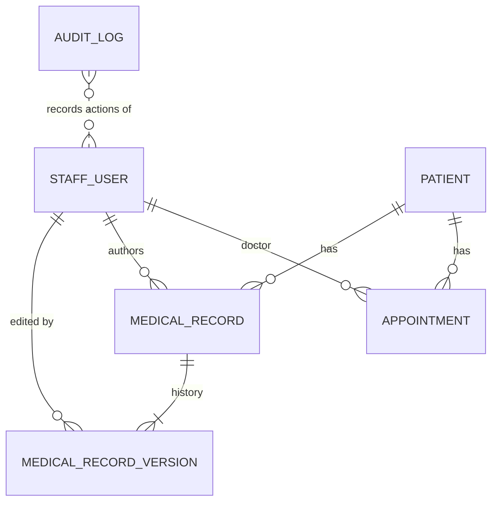

# Hospital Patient Record Management System

A secure backend for managing patients, appointments and clinical records, built with **Spring Boot 3.5, Java 21 and Maven**.
Staff log in with JWT tokens; what each person can see and do depends on their role.
A **React web interface** is included in the [`frontend/`](frontend/README.md) folder.

**What it demonstrates:** role-based access control plus a doctor-patient care relationship, double-booking prevention
under concurrency (pessimistic locking), versioned clinical records with optimistic locking, an append-only audit trail,
soft deactivation instead of deletion, validation, consistent error responses, pagination/search, and integration tests.

The full problem statement is in [`docs/PROBLEM_STATEMENT.md`](docs/PROBLEM_STATEMENT.md).

> **Fictional data only.** Never load real patient information into this project without a proper legal and security review.

## Requirements

- JDK 21 or newer (21 and 25 both work). Check with `java -version`.
- Maven 3.9+ (`mvn -v`), or open the folder in IntelliJ IDEA / VS Code, which bring their own Maven.
- Docker (optional, only for PostgreSQL instead of the default in-memory H2).

## Run it

```bash
mvn test              # run the end-to-end tests
mvn spring-boot:run   # start the API on http://localhost:8080
```

By default it uses an in-memory H2 database (data is wiped on restart) and creates some **fictional demo data**:

| Account | Email | Password |
|---------|-------|----------|
| Administrator | `admin@hospital.test` | `Admin@12345` |
| Doctor (Cardiology) | `dr.rao@hospital.test` | `Password@123` |
| Doctor (General Medicine) | `dr.iyer@hospital.test` | `Password@123` |
| Nurse | `nurse.priya@hospital.test` | `Password@123` |
| Receptionist | `reception@hospital.test` | `Password@123` |
| Patient (Asha Verma) | `asha.verma@patient.test` | `Password@123` |

Plus three demo patients (Asha has a login) and one appointment for tomorrow with Dr. Rao. Set `SEED_DEMO_DATA=false` to start without them
(the administrator is always created if no admin exists yet).

### The web interface

With the backend running, open a second terminal (needs Node.js 20.19 or newer):

```bash
cd frontend
npm install
npm run dev
```

Then open <http://localhost:5173> and sign in with one of the demo accounts. Details are in
[`frontend/README.md`](frontend/README.md).

### With PostgreSQL

```bash
docker compose up -d
mvn spring-boot:run -Dspring-boot.run.profiles=postgres
```

Connection settings are in `src/main/resources/application-postgres.properties`
and can be overridden with `DB_URL`, `DB_USERNAME`, `DB_PASSWORD`.

### Before using it anywhere real

Set your own `JWT_SECRET` (32+ characters), `ADMIN_EMAIL` and `ADMIN_PASSWORD`, and `SEED_DEMO_DATA=false`.

## Who can do what

| | Admin | Doctor | Nurse | Receptionist | Patient |
|---|:-:|:-:|:-:|:-:|:-:|
| Create / deactivate staff accounts | yes | | | | |
| Read the audit log | yes | | | | |
| Register / edit patients | yes | | | yes | |
| Deactivate / reactivate patients | yes | | | | |
| View patient details and search | yes | yes | yes | yes | |
| Book / reschedule appointments | yes | | | yes | |
| Book / cancel **their own** appointments | | | | | yes |
| Cancel appointments | yes | own only | | yes | own only |
| Complete appointments | | own only | | | |
| See appointments | all | own only | all | all | own only |
| **Create** clinical records | | patients they have an appointment with | | | |
| **Edit** a clinical record | | the authoring doctor only | | | |
| **Read** clinical records | | patients they treat | all (read-only) | | |

Design choices behind this table:

- **Least privilege:** administrators and receptionists run the hospital but have no clinical access at all.
- **Care relationship:** a doctor reads a patient's records only if they have a (non-cancelled) appointment with that patient
  or wrote a record for them. Otherwise they get a `403`.
- **Patients** have their own login (see below) but no clinical access of any kind: they cannot read records, not even their own.
  Clinical history is for doctors, and read-only for nurses.
- **Nurses** can read any record (read-only). Every read is audited. A real system would restrict nurses to their ward or
  assigned patients; that is listed under future work.

### Patient logins

Staff accounts are created by an administrator. Patients create their **own** login on the sign-up page:

1. The patient record is created first, by the front desk. This gives the patient an MRN.
2. The patient opens **Create your account** and enters the MRN, their date of birth, an email and a password.
3. The server checks the MRN and date of birth against the patient record. Whatever goes wrong (unknown MRN, wrong date of
   birth, a login already exists, email already used, patient deactivated) the answer is the same message, so the form
   cannot be used to find out who is a patient. Failed attempts are audited (`REGISTER_FAILED`).
4. A patient can book, list and cancel only their own appointments. The patient is taken from the login, never from the
   request, so there is no id to tamper with. Deactivating the patient record also blocks the login immediately.

## API

Send the token as `Authorization: Bearer <token>`. Lists are paged: `page` (from 0), `size` (max 50), `sort` (e.g. `sort=fullName,asc`).

| Method | Path | Roles | Description |
|--------|------|-------|-------------|
| POST | `/api/auth/login` | public | Log in, returns a token |
| POST | `/api/auth/register` | public | A patient creates their login (`mrn`, `dateOfBirth`, `email`, `password`) |
| GET | `/api/auth/me` | any | Current user |
| POST | `/api/admin/staff` | admin | Create a staff account (`role`: `ADMIN`, `DOCTOR`, `NURSE`, `RECEPTIONIST`) |
| GET | `/api/admin/staff?role=DOCTOR` | admin | List staff |
| PATCH | `/api/admin/staff/{id}/active` | admin | Deactivate / reactivate (`{"active": false}`) |
| GET | `/api/admin/audit` | admin | Audit log. Filters: `actorEmail`, `action`, `entityType`, `entityId` |
| GET | `/api/doctors` | any | Active doctors (id, name, specialization) |
| GET | `/api/me/appointments` | patient | The patient's own appointments |
| POST | `/api/me/appointments` | patient | Book for themselves (`doctorId`, `startTime`, `reason`; 30 minutes, `409` if the doctor is busy) |
| POST | `/api/me/appointments/{id}/cancel` | patient | Cancel their own appointment (someone else's is `404`) |
| POST | `/api/patients` | admin, receptionist | Register a patient (returns an MRN) |
| GET | `/api/patients?q=asha&active=true` | any | Search by name, MRN or phone |
| GET | `/api/patients/{id}` | any | One patient (the view is audited) |
| PUT | `/api/patients/{id}` | admin, receptionist | Update demographics |
| PATCH | `/api/patients/{id}/active` | admin | Deactivate / reactivate |
| POST | `/api/appointments` | admin, receptionist | Book (`409` if the doctor is busy) |
| GET | `/api/appointments?doctorId=&patientId=&status=&date=2026-11-05` | any | List (doctors see only their own) |
| GET | `/api/appointments/{id}` | any | One appointment |
| PUT | `/api/appointments/{id}/reschedule` | admin, receptionist | Move to a new time |
| POST | `/api/appointments/{id}/cancel` | admin, receptionist, doctor | Cancel |
| POST | `/api/appointments/{id}/complete` | doctor | Mark as completed |
| POST | `/api/patients/{patientId}/records` | doctor | Create a clinical record |
| GET | `/api/patients/{patientId}/records` | doctor, nurse | List a patient's records |
| GET | `/api/records/{id}` | doctor, nurse | One record |
| PUT | `/api/records/{id}` | doctor (author) | Edit (needs `changeReason`, bumps the version) |
| GET | `/api/records/{id}/history` | doctor, nurse | All versions of a record |

`requests.http` has a ready-to-click walkthrough for IntelliJ or the VS Code "REST Client" extension.

### Try it with curl

```bash
# Log in as the receptionist and as the doctor
curl -s -X POST localhost:8080/api/auth/login -H "Content-Type: application/json" \
  -d '{"email":"reception@hospital.test","password":"Password@123"}'
curl -s -X POST localhost:8080/api/auth/login -H "Content-Type: application/json" \
  -d '{"email":"dr.rao@hospital.test","password":"Password@123"}'
# copy each "token" value into REC and DOC below

REC="paste-receptionist-token"; DOC="paste-doctor-token"

# Receptionist: find a patient, then see the doctors
curl -s "localhost:8080/api/patients?q=asha" -H "Authorization: Bearer $REC"
curl -s localhost:8080/api/doctors -H "Authorization: Bearer $REC"

# Doctor: write a clinical record for Asha (she has an appointment with Dr. Rao)
curl -s -X POST localhost:8080/api/patients/1/records -H "Authorization: Bearer $DOC" \
  -H "Content-Type: application/json" \
  -d '{"diagnosis":"Mild hypertension","prescription":"Amlodipine 5 mg","notes":"Review in 4 weeks"}'

# Receptionist tries to read it -> 403
curl -s -i localhost:8080/api/records/1 -H "Authorization: Bearer $REC"
```

## Data model



- `MedicalRecord` holds the **current** content. Every create and edit also writes an immutable `MedicalRecordVersion`.
- `AuditLog` is append-only and stores who did what to which entity, never clinical content.

## How the important parts work

- **No double booking.** Scheduling first takes a database lock on the doctor's row, then checks for overlapping
  appointments. Two simultaneous bookings for the same doctor are processed one after the other, so the second sees the first.
  Back-to-back slots are allowed.
- **No lost edits.** `MedicalRecord` has an optimistic-lock `@Version`. If two doctors save at the same moment, the second
  gets `409 Conflict` instead of silently overwriting the first.
- **Audit trail.** `AuditService` writes each entry in its own transaction, so reads can be logged too and a failed
  operation still leaves a trace. Logins, failed logins, patient and record views, creations, edits, cancellations and
  account changes are all recorded.
- **Deactivation, not deletion.** Deactivated staff cannot log in and their existing tokens stop working immediately
  (the user is re-checked on every request). Deactivated patients disappear from search and cannot be booked, but their
  history is kept.
- **No account enumeration.** Wrong email, wrong password and deactivated account all return the same `401` message.

## Project structure

```
src/main/java/com/hospital/records
  HospitalRecordsApplication.java
  controller/    HTTP layer + @PreAuthorize role rules
  service/       business rules (access checks, booking, versioning, audit, patient portal)
  repository/    Spring Data JPA interfaces
  domain/        JPA entities and enums
  dto/           request/response records (what the API exposes)
  security/      JWT service, auth filter, security config, Actor
  exception/     custom exceptions + one handler producing JSON errors
  config/        DataSeeder (first admin + demo data)
  util/          SortValidator
src/test/java/com/hospital/records/HospitalApiTests.java   end-to-end tests (staff side)
src/test/java/com/hospital/records/PatientPortalTests.java  end-to-end tests (patient logins)
frontend/                                                  React web interface (see frontend/README.md)
```

## Known limitations and future work

- Patient sign-up has no rate limiting or email verification; a real system would add both, plus a one-time code sent to the
  phone or email on file instead of relying on MRN + date of birth.
- Patients cannot see a doctor's free slots, only get a `409` when a slot is taken, and cannot reschedule (cancel and rebook).
- Single hospital site, one time zone, no working hours or leave calendar for doctors.
- Nurses can read all records; restrict them to assigned wards/patients.
- No "break-glass" emergency access with mandatory justification.
- Uses `ddl-auto=update`; production should use Flyway or Liquibase migrations.
- No refresh tokens or token revocation list (deactivation already blocks tokens).
- Ideas: PDF export of a visit summary, patients viewing their own results with consent, lab results, billing, OpenAPI/Swagger UI,
  Docker image and CI pipeline.
